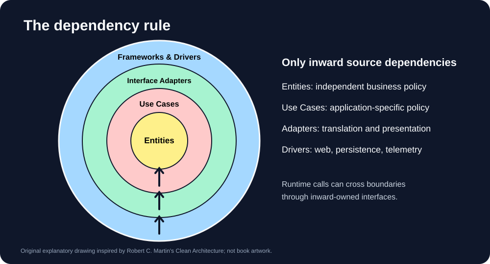
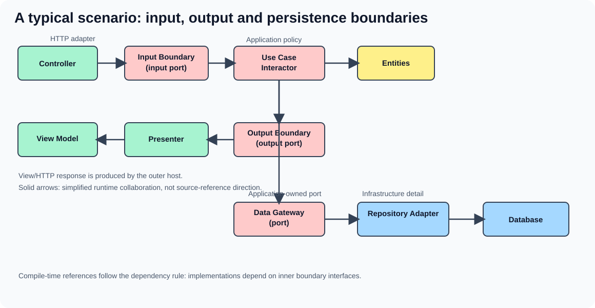

# 競賽平台 — Clean Architecture 實務範例

[English](README.md) · [繁體中文](README.zh-TW.md) · [日本語](README.ja.md)

> 以 Robert C. Martin《Clean Architecture》為架構依據，從零開發的公開教學範例：競賽、排行榜、個人歷史紀錄與資料防護。**不宣稱已具備生產環境等級的防作弊能力。**

## 專案目標

參賽者經過身分驗證後報名競賽，提交附有可信證據的成績。系統保存決策歷史、產出可預測的排名，並提供個人歷史查詢。非法輸入、越權、重送、並發、過期與外部服務失效都必須是設計與測試的一部分。

**最重要的規則：原始碼依賴只能向內。** 業務政策不認識 HTTP、資料庫、框架、Logger 或傳輸技術。最外層的 Composition Root 負責組裝。

## 兩張核心架構圖

### 1. Clean Architecture 四圈與依賴規則



- **Entities（企業業務規則）**：穩定且與技術無關的競賽規則與不變條件。
- **Use Cases（應用業務規則）**：報名、成績驗證、歷史與排行榜等應用政策。
- **Interface Adapters（介面轉接器）**：Controller、Presenter、Gateway Adapter 和 View Model。
- **Frameworks & Drivers（框架與驅動）**：ASP.NET Core、EF Core、PostgreSQL、Telemetry。

圖中箭頭代表**原始碼相依**，不等同於實際呼叫方向。

### 2. 典型請求與回應流程



1. **Controller** 將 HTTP 輸入轉成簡單的 **Input Data**，呼叫 **Input Boundary**。
2. **Use Case Interactor** 執行應用規則，並使用 **Entities**。
3. Interactor 依賴應用層定義的 **Gateway 介面**，由外層 PostgreSQL Adapter 實作。
4. Interactor 將 **Output Data** 送至 **Output Boundary**，由外層 **Presenter** 實作。
5. Presenter 建立 **View Model**，Web Host 負責 HTTP Response。核心不依賴 ASP.NET Core 與 EF Core。

執行期控制流程可能向外呼叫具體實作，但編譯期**依賴方向仍向內**，這是依賴反轉的要點。

## 專案與職責

| 圈層 | 專案 | 責任 |
| --- | --- | --- |
| Entities | `Competition.Domain` | 業務規則、不變條件；無框架依賴 |
| Use Cases | `Competition.Application` | Interactor、Input/Output Boundary、簡單資料模型與 Ports |
| Interface Adapters | `Competition.Adapters` | Presenter、View Model、介面轉換 |
| Frameworks & Drivers | `Competition.Infrastructure`、`Competition.Web` | PostgreSQL、EF Core、ASP.NET Core、Logging、Telemetry |
| Tests | `Competition.*.Tests` | 驗證規則、邊界、失敗情境與禁止依賴 |

Repository **介面**由需要它的內圈持有；EF Core **實作**位於外圈。Domain 不應注入 `ILogger`，Use Case 也不能傳遞 HTTP DTO。

## 功能與資料可信度

| Use Case | 規則 | 防護 |
| --- | --- | --- |
| Create Competition | 競賽期間、計分政策 | 時間區間無效、識別碼衝突 |
| Register Participant | 身分與報名資格 | 越權、報名截止、重複報名 |
| Submit Result | 可信證據先於正式成績 | 假成績、重播、冪等鍵衝突 |
| Get Leaderboard | 明確排序與平手規則 | 分頁範圍、即時與結算排名 |
| Get Personal History | 不覆寫的成績決策歷程 | 權限、來源鏈、並發 |
| Correct Result | 有權限且附理由的更正 | 版本衝突、交易失敗與稽核 |

**不能直接相信玩家自行上傳的分數。** 認證證明「誰送出的」，不證明「分數是真的」；正式接受結果須有可信機構提供的證據或伺服器可獨立驗證的規則。簽章金鑰不能傳給玩家。

**Log 不等於業務稽核。** 結構化 Log 和 Trace 用來追查執行狀態；稽核紀錄保存決策。不可把 Token、密鑰或整份不可信輸入寫入 Log。

## 測試與驗收

- Domain 單元測試：有效／無效狀態、邊界值、作弊輸入、平手排名。
- Interactor 測試：嚴格 Port Fakes，驗證授權、冪等與 Output Boundary。
- 架構測試：**真正檢查依賴方向**，違規必須測試失敗。
- PostgreSQL 整合測試：使用真實容器驗證 Unique Constraint、Transaction、Concurrency；不以 InMemory 資料庫取代。
- HTTP 測試：經認證的請求與錯誤回應。
- 負向控制：刻意製造錯誤，證明驗證器會失敗。
- 公開掃描：採 Repository 外維護的禁止識別字清單，不將機密清單寫進公開程式碼。

未取得 CI 成功證據之前，README **不宣稱**所有測試已通過。

## 開發

需要 .NET 10 SDK；PostgreSQL 整合測試需要 Docker。建立方案後由 Repository 根目錄執行 `dotnet test`。資料庫連線與正式認證設定經由環境變數注入，**不提交憑證**。

## 書中原則與程式碼對照

| 參照章節 | 專案落點 |
| --- | --- |
| Ch. 20 Business Rules | Domain 業務規則與不變條件 |
| Ch. 22 The Clean Architecture | 向內依賴、Input/Output Ports、Presenter 與 Gateway |
| Ch. 23 Presenters and Humble Objects | Presenter 處理 View Model，Interactor 不做格式化 |
| Ch. 26 The Main Component | Web Host 組裝具體實作 |
| Ch. 28 The Test Boundary | 使用架構邊界建立可隔離的測試 |
| Ch. 30–32 | Database、Web 和 Frameworks 是可替換細節 |

**出處：** Robert C. Martin，《Clean Architecture: A Craftsman's Guide to Software Structure and Design》（Pearson，2017）；另參考 [作者原始文章](https://blog.cleancoder.com/uncle-bob/2012/08/13/the-clean-architecture.html)。兩張 SVG 是本專案新繪製的原理示意圖，**不是出版圖片複製品**。資料庫、Outbox、防作弊、可觀測性與技術選型是本範例的工程決策，**不是作者在書中強制指定**。

## 範圍邊界

採用單體模組化架構示範明確分層。沒有可信的成績來源就無法保證玩家沒有作弊；不能保證跨系統訊息真正 Exactly Once；也不將任何特定框架誤認為書中規定。以可執行、可驗證的證據優先。

## 目前實作的 HTTP 契約

| 路由 | 授權 | 行為 |
| --- | --- | --- |
| `POST /api/competitions` | OIDC 登入並具有 competition-admin 角色 | 建立具期間與計分上限的競賽 |
| `POST /api/competitions/{id}/participants` | OIDC 登入 | 依已驗證身分報名，不採用請求自行宣稱的參賽者身分 |
| `POST /api/competitions/{id}/results` | OIDC 登入、限流 | 必須傳入 `Idempotency-Key` 和 `OpaqueEvidence`；只有可信證據能寫入成績 |
| `POST /api/competitions/{id}/results/{resultId}/corrections` | competition-admin 角色 | 寫入保留版本與理由的稽核更正 |
| `GET /api/competitions/{id}/leaderboard` | 公開 | 依最新有效成績（含更正）產生排名 |
| `GET /api/competitions/{id}/me/history` | OIDC 登入 | 僅查詢本人原始成績與更正歷程 |
| `GET /health` | 公開 | 僅代表程序存活，**不代表資料庫可用** |

### 成績來源與完整性

**可信收據 Adapter** 會驗證 HMAC 簽章，綁定競賽、參賽者、分數、證據識別碼及簽發／到期時間。簽章密鑰只能由**獨立可信的成績裁定端**保管，絕不能交給玩家、瀏覽器或手機 App。簽章只能證明聲明來自特定簽發端，**不能單獨證明遊戲過程沒有作弊**；本範例不包含完整遊戲伺服器或證據簽發器。

冪等鍵與請求證據綁定。PostgreSQL Adapter 在**同一交易**寫入正式成績、冪等收據、業務稽核紀錄，以及待發送的版本化 Outbox 事件。事件成功入庫**不代表外部發送成功**。唯一約束保護重播與並發寫入。更正以新增版本與稽核決策方式處理，不覆蓋原始成績。排行榜採最新有效版本，個人歷史保留所有版本。

越權、無效證據、相同冪等鍵卻不同內容，以及過期的更正版本，都不能冒充成功。這些行為使用真正 PostgreSQL Docker 容器進行整合測試，而不是僅用 Mock。

### Log、Trace 與正式稽核

- **Operational Log**：只記錄 HTTP 結果、處理時間、Trace 關聯及穩定的結果代碼，不記錄證據原文、JWT 或簽章密鑰。
- **Tracing / Metrics**：OpenTelemetry 只配置在最外層 Web Driver；預設**不對外傳送**，設定 `Telemetry__ExportOtlp=true` 並提供 Collector 端點才會啟用。
- **Business Audit**：成績接受與更正歷程寫入 PostgreSQL，和業務交易一起 Commit。Log **不能取代**正式稽核紀錄。
- **CA 邊界**：Entities 與 Interactors 不引用 `ILogger` 或 OpenTelemetry。

## 本地執行

需要 .NET 10 SDK、Docker，以及**另外配置的 OIDC 身分提供者**。本範例不提供預設管理者帳號、提交至 Git 的密鑰或略過驗證的捷徑。

1. 在本機設定強密碼 `POSTGRES_PASSWORD`，可複製 `.env.example` 為不追蹤的 `.env`。
2. 執行 `docker compose up -d postgres`。
3. 透過環境變數提供：

   - `ConnectionStrings__Competitions`：包含本機 PostgreSQL 密碼的連線字串
   - `Authentication__Authority`：HTTPS OIDC 簽發者
   - `Authentication__Audience`：Token 必須符合的 API Audience
   - `TrustedAuthority__SigningKeyBase64`：至少 32 個隨機位元組的 Base64，**只與可信成績裁定端共享**
   - `Database__BootstrapOnStart=true`：**僅限 Development**，對全新或已由 Migration 管理的資料庫套用四個已納管的 EF Core 版本化 Migration；正式環境絕不自動套用

4. 執行 `dotnet run --project src/Competition.Web/Competition.Web.csproj --environment Development`。
5. 使用 `GET /health` 確認程序存活；其他受保護 API 需使用正式驗證的 Access Token。

提交的 `OpaqueEvidence` 必須由可信端簽發；自行修改 JSON 不會獲得有效成績。請勿將 Token、密碼、真實位址或密鑰放入 Git／Log。

## 完整驗證指令

```bash
dotnet test tests/Competition.Domain.Tests/Competition.Domain.Tests.csproj -c Release
dotnet test tests/Competition.Application.Tests/Competition.Application.Tests.csproj -c Release
dotnet test tests/Competition.Adapters.Tests/Competition.Adapters.Tests.csproj -c Release
dotnet test tests/Competition.Infrastructure.Tests/Competition.Infrastructure.Tests.csproj -c Release
dotnet test tests/Competition.Web.Tests/Competition.Web.Tests.csproj -c Release
dotnet test tests/Competition.Architecture.Tests/Competition.Architecture.Tests.csproj -c Release
dotnet test tests/Competition.Integration.Tests/Competition.Integration.Tests.csproj -c Release
python3 scripts/check_publication.py
```

整合測試使用真正的暫時性 PostgreSQL 容器，驗證交易、並發提交、重播、唯一約束、同時更正以及資料隔離。CI 將整合測試與不依賴資料庫的單元／架構測試分開執行。

## 明確保留的限制

本專案是**教學型模組化單體**，不是完整的正式上線產品。目前不內建 OIDC 提供者、可信遊戲裁定端、完整反作弊機制、賽季結算排名快照、獨立部署並經生產驗證的 Webhook 接收服務、Exactly-once 訊息處理、完整的生產環境營運操作介面或跨系統可靠投遞驗收。報名與成績寫入現已在 PostgreSQL 交易內重新呼叫 Domain 規則；判定時間是交易內的受信任 UTC Clock，不是 Commit 時間。若需要嚴格的資料庫提交時間截止線，或允許其他寫入者修改競賽期限，仍需額外設計與驗證。必須由成功執行的 CI 提供測試證據；CI 綠燈不等於所有安全性或書中原則都已取得最終簽核。**書中架構規則**與**本範例採用的工程實作策略**明確分開。

## 可選啟用的 Outbox 送達流程與限制

本範例現在已在最外層 Web Driver 加入**可選啟用的 HTTPS Webhook Dispatcher**，並由 PostgreSQL 保存投遞狀態：

- 設定 `Outbox__Enabled=true` 及 `Outbox__WebhookUrl=https://your-trusted-receiver.example/events` 才會開啟投遞；預設完全不對外發送。
- PostgreSQL 使用 `FOR UPDATE SKIP LOCKED`、限時租約與隨機租約 Token，在多個 Worker 同時處理時避免領到相同待處理事件。
- 送出的 JSON Envelope 包含固定 `EventId`、`EventType`，以及 `Idempotency-Key` Header。**接收端必須持久化事件 ID 來防止重複處理**。
- HTTP 2xx 才能確認投遞；408、429、5xx 與網路失敗會重試，其他 4xx 視為永久失敗。
- 暫時失敗使用有上限的退避時間；連續五次失敗進入 **Dead Letter**，需要營運者檢查。
- 若接收端已處理成功、但發送端在保存確認之前當機，租約到期後仍**可能再次投遞**。這是 **At-least-once 投遞嘗試**，不是 Exactly-once 保證。
- 不跟隨 HTTP Redirect、只接受操作人員設定的 HTTPS 目標，也不將敏感資料或外部回應原文寫進 Log。

**版本化 Migration：** 已納管 `BaseCompetition`、`DurableOutbox`、`InboxProjection`、`OperatorRedriveAudit` 四個 EF Core Migration。整合測試驗證全新建置、保留舊資料的版本升級、重複套用及 Model Snapshot 漂移。僅 Development 的 `Database__BootstrapOnStart=true` 現在呼叫 `MigrateAsync`，不再使用 `EnsureCreated`。**若舊開發資料庫原先由 `EnsureCreated` 建立，沒有 EF Migration History，應先備份並審查基準導入方式，不能直接破壞或清除資料。** 正式環境 Migration 必須由獨立部署流程審查套用，不能交給 Web 啟動自動變更。

目前已有 PostgreSQL 真實租約競爭、接手、過期 Token 拒絕、退避與 Dead Letter，以及 HTTP Handler 回應分類測試。但**尚未驗證獨立部署的正式外部接收服務，也還沒有完整的營運監控／審批操作介面**。


## 已通過的完整 HTTP 情境測試

`AuthorizedHttpJourneyTests` 使用**真正的 ASP.NET Core HTTP Pipeline 與 PostgreSQL Testcontainers**，搭配只存在測試環境的有效簽章 JWT 和可信 HMAC 收據，實際走完競賽建立、報名、首次提交、相同冪等鍵重送、排行榜、個人歷史、管理者成績更正，以及資料庫的 Audit / Outbox 驗證。

這是**測試專用的本地簽發者**，不等於外部 OIDC 服務或正式遊戲裁定系統。實際成功紀錄：[GitHub Actions 39380576833](https://github.com/sky1116/clean-architecture-sample/actions/runs/39380576833)，當時 **67 項測試通過，包含 13 項 PostgreSQL 整合測試**，另有文件檢查成功；測試數量會隨後續版本調整。


## 寫入交易中的資格與時間判定

系統採**兩層不同時機、同一套業務規則**：Use Case 先拒絕明顯不合法的輸入；真正寫入時，PostgreSQL Gateway 在交易內重新取得正式競賽與報名狀態，再呼叫**同一個 Domain Entity 規則**，不複製第二份時間／分數公式。

- 先前已成功的報名或成績提交，即使賽事已截止，仍可正確回傳冪等結果，但不得寫入第二筆。
- 新報名若超過 `StartsAt`、新成績超出 `StartsAt`～`EndsAt`、或參賽者未報名，都在交易內拒絕，並不得新增正式成績、收據、Audit 與 Outbox。
- 時間判定依據交易內的受信任 `IUtcClock`，**不是 HTTP 抵達時間，也不是資料庫 Commit 時間**。本 Sample 假設競賽時段與已報名紀錄一旦建立就不可變；這並不構成嚴格的提交瞬間截止保證。
- 真實 PostgreSQL 整合測試驗證跨截止時間、未報名、重送冪等與競爭報名。

**Domain 負責規則，Infrastructure 負責交易與持久化**，避免任何框架成為第二套業務規則來源。


## Migration 與交易截止條件驗證（特定版本）

[GitHub Actions 39386303105](https://github.com/sky1116/clean-architecture-sample/actions/runs/39386303105) 在此版本通過 **76 項測試**：其中 **22 項使用真正 PostgreSQL 容器的整合測試**，其餘 54 項為單元／架構／HTTP／Adapter 測試，三語文件檢查亦通過。案例涵蓋保存舊資料的 Schema 升級、重跑 Migration、Model Snapshot 漂移、交易內截止時間、截止後合法重送及並發報名。測試數字僅代表這次提交的實際執行證據，不代表未來版本自動通過。


## 接收端 Webhook 與持久化 Inbox 實務範例

本專案已新增示範接收端 `POST /api/integrations/result-events`，**預設停用**。只有信任的伺服器間傳輸才應設定 `Inbox__Enabled=true`，並透過環境設定提供至少 32 個隨機位元組的 `Inbox__WebhookSigningKeyBase64`。發送端的 `Outbox__WebhookSigningKeyBase64` 必須使用**相同的受信任共享金鑰**，`Outbox__WebhookUrl` 則指向由管理者設定的 HTTPS 接收網址。金鑰絕不能放進 Git 或玩家裝置。

發送端以 HMAC-SHA256 簽署**實際傳送的 JSON 位元組**；接收端先檢查 `X-Webhook-Signature: v1=...`，**驗證成功後才解析 JSON**，並核對 `X-Event-Id`、`X-Event-Type`、版本、事件識別碼及 8 KiB 大小限制。範例仍屬同一模組化單體內的整合端點，**不是獨立部署且已受生產驗證的接收服務**。

內圈 `ReceiveResultEventInteractor` 依賴 `IResultInboxPort`；外圈 PostgreSQL Adapter 在**同一交易**中保存 Inbox 收據與獨立的 `ReceivedResults` 投影。收到的 Webhook **不會直接修改正式 `Results` 或公開排行榜**。相同 EventId 與內容的重送只回傳既有結果；相同 ID 內容改變視為衝突；更正事件若先於原始事件抵達，會回傳 HTTP 503 供重試。更正必須依版本順序到達，前置事件長期缺失仍可能造成發送端進入 Dead Letter。

真實 HTTP／PostgreSQL 測試涵蓋有效簽章、偽造與竄改拒絕、重送、內容衝突、亂序、停用端點、過大輸入；資料庫整合測試另涵蓋並發、重新啟動後重送與交易一致性。**Inbox 去重不等於跨服務 Exactly-once 保證，也不是正式外部網路環境驗收。**

[最新 Inbox HTTP/PostgreSQL 成功紀錄：94 項測試](https://github.com/sky1116/clean-architecture-sample/actions/runs/39390851699)，包含 34 項 PostgreSQL 整合測試及其餘 60 項測試，文件檢查亦通過。數字僅適用於該 Commit。


## 有權限控管的 Dead Letter 重送與稽核

系統可選擇設定 `Outbox__RecoveryEnabled=true`（預設關閉），由具有已驗證 JWT 與 `competition-admin` 角色的管理者呼叫 `POST /api/operations/outbox/{eventId}/redrive`，並提交 8–300 字元的 JSON `Reason`。重送功能與背景發送器是否啟用分開控制。

內圈 **Application Interactor** 驗證管理員身分與理由，並透過 Application Port 提出操作；外圈 **PostgreSQL Adapter** 鎖定事件、拒絕已發布／認領中／不屬於 Dead Letter 的資料，在同一交易將合法事件重新排入待送，並建立 `OutboxRecoveryAudit`，保存操作人員、原因、之前嘗試次數與時間。多位管理員同時操作，最多只能有一筆成功。**重送不會略過 Webhook 簽章，也不代表遠端一定會成功。**

另外，Inbox 更正版本的狀態轉移現已移至無框架相依的 **Domain `ReceivedResultPolicy`**；Infrastructure 只取得現有投影、呼叫 Domain 計算下一狀態，再與 Inbox 收據原子性保存，不再自己維護第二套版本規則。

API 與整合測試包含真實 JWT 授權、實際 HTTP、PostgreSQL 交易、未授權拒絕、只能重送一次、已送達事件不得重送，以及不可刪改的稽核資料。本範例仍不包含正式營運儀表板、審批流程、金鑰輪替或獨立部署驗收。


## 架構稽核檢查點：書中原則與程式驗證證據

這是**程式碼與測試的稽核檢查點**，不是宣稱已逐頁證明整本書、正式部署或未來所有修改皆百分之百合規。章節對照用來解釋設計理念，並非引用書籍原文，也不代表書中要求特定套件與慣用寫法。

| 《Clean Architecture》概念 | 對應程式 | 實際驗證內容 |
| --- | --- | --- |
| Dependency Rule（第 22 章） | `Competition.Domain`、`Application`、`Adapters`、`Infrastructure`、`Web` | `ProjectGraphPolicy` 核對正式專案的**完整引用圖**與未知專案；負向測試真的插入違規引用或內圈套件，並交給**相同檢查器**處理；另外檢查編譯後內圈 Assembly 引用。 |
| Entities／核心業務規則（第 20 章） | `Competition`、`RankingPolicy`、`ReceivedResultPolicy`、`CorrectionRevisionPolicy` | Domain 不依賴資料庫或 Web；測試涵蓋競賽期間、分數、排名及版本轉移。更正版本是否可推進由 Domain 決定，不由 PostgreSQL 另寫一套政策。 |
| Use Cases 與依賴反轉（第 22 章） | `UseCases/*`、`Ports/*` | Interactor 依賴 Application 自身定義的 Port／Boundary 與 Domain；架構測試自動發現各 Input／Output Boundary，新增 Use Case 不應悄悄避開檢查。 |
| Controller → Input Boundary（第 22 章） | `CompetitionController`、`Program.cs` | Controller 呼叫輸入介面，不直接依賴具體 Interactor；HTTP 與 JWT 身分轉換仍在外圈。 |
| Output Boundary → Presenter → View Model（第 23 章） | `RestPresenter`、`ApiViewModel` | 反射驗證 Input／Output DTO 不攜帶 Domain Entity 或 EF 資料列，且外圈 Presenter 實作正式宣告的所有輸出介面。 |
| Database／Framework 為細節（第 30–32 章） | `Postgres*Gateway`、`CompetitionDbContext`、`Migrations/*` | EF Core／Npgsql 留在 Infrastructure；真正 PostgreSQL 整合測試驗證原子性、並發、Inbox／Outbox、Migration 升級。 |
| Main Component／Test Boundary（第 26、28 章） | `Program.cs`、測試專案與 GitHub CI | 最外圈 Web 負責組裝具體類別；Domain、Use Case、架構、HTTP 與 PostgreSQL 在不同測試層驗證。 |

**本次找到並修正的行為落差：** 已接受過的成績及報名必須先做冪等查詢，不能因現在已截止就拒絕查回原決策。完全相同的已接受成績即使證據過期也只讀回既有結果；過期的新請求、同一鍵卻不同內容的請求仍被拒絕。真正新增成績的 PostgreSQL 交易仍會重新確認 Domain 的競賽期間與報名資格，並由 Use Case／真實 HTTP 測試覆蓋。

**驗證邊界：** 目前檢查專案 XML、編譯後 Assembly 依賴、Boundary 名稱與 DTO 結構；不能把這些測試說成已窮盡所有 MSBuild Import、反射動態載入、部署機密管理或書籍全文逐頁驗證，也不代表遊戲真實性、跨服務 Exactly-once 或資料庫 Commit 瞬間截止的保證。**PR 在獨立 Review 前仍維持 Draft；CI PASS 是特定版本的證據，不是無條件架構簽核。**

